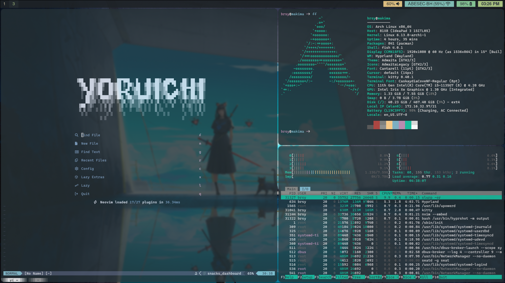

# Dotfiles

these are my current nix configs; \
these include m4pro, x86-64vm, nixos-anywhere config;

## Layout

- `modules/common/`: home manager modules that are the same on macOS and Linux (no platform checks inside)
- `modules/darwin/`: macOS only, including the macOS halves of shared programs (nushell's PATH, the Ghostty app)
- `modules/linux/`: Linux only (nushell's PATH, Ghostty from source, Hyprland)
- `hosts/<name>/`: each machine imports `common/` plus its platform's directory

## Setup

To use nix-darwin, use `makima`; also read this [article](https://www.briheet.com/blogs/nix-darwin-home-manager/)
```bash
sudo darwin-rebuild switch --flake github:briheet/nix-config#makima
```

To install nixos on vm and use it via home manager, check `vm` and `zangetsu`;
```bash
# Install nixo-anywhere on vm. First add pub key in nix-config/systems/hetzner/secrets.txt
nix run github:nix-community/nixos-anywhere -- --build-on remote --flake .#vm --target-host zangetsu

# Then rebuild vm via home manager
nix run nixpkgs#nixos-rebuild -- --flake .#zangetsu --build-host zangetsu --target-host zangetsu switch
```

NixOS on the MacBook Pro M4 Pro, `kyokasuigetsu`. The hardware, the SSD layout and the boot chain (m1n1 → U-Boot → extlinux) come from [nixos-m4pro](https://github.com/briheet/nixos-m4pro), which also does the first install; this repo is the machine's own config. On the Mac:
```bash
git clone git@github.com:briheet/nix-config.git ~/nix-config
cd ~/nix-config
sudo nixos-rebuild switch --flake .#kyokasuigetsu      # each change; persists across reboots

nix flake update nixos-m4pro                   # newer kernel, firmware or boot chain
sudo nixos-rebuild switch --flake .#kyokasuigetsu
```
Every switch adds a generation to U-Boot's boot menu; the older ones stay there as fallbacks. The Apple firmware (trackpad, Wi-Fi, Bluetooth) is a fixed-output path that nixos-m4pro pins by hash; a fresh machine gets it from nixos-m4pro's `tools/mac-firmware`.

## Macos setup


## Old Setup

### Plain Desktop



### SDDM


### GRUB


### Desktop Wallpaper


